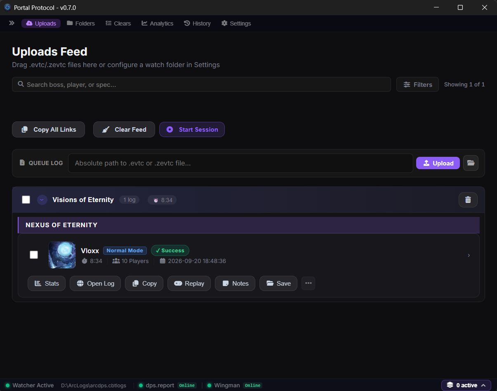
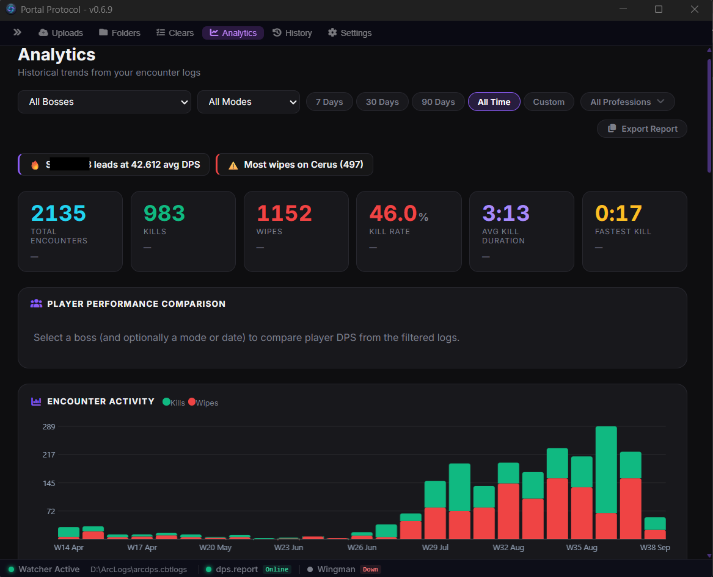
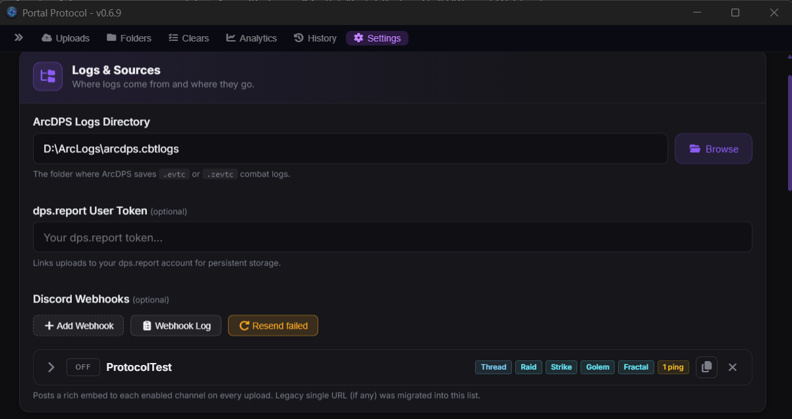

# Portal Protocol

<div align="center">

[](https://tauri.app)
[](https://svelte.dev)
[](https://www.rust-lang.org)
[](LICENSE)
[](https://github.com/Mestiak/Portal-Protocol/releases)
[](https://github.com/Mestiak/Portal-Protocol)

**GW2 combat log uploader, Discord webhook integration, and analytics suite.**

*Upload ArcDPS logs to dps.report, track clears, manage sessions, and notify your Discord — all from one app.*

[⬇ Download for Windows](https://github.com/Mestiak/Portal-Protocol/releases) · [🍎 macOS](https://github.com/Mestiak/Portal-Protocol/releases) · [🐧 Linux](https://github.com/Mestiak/Portal-Protocol/releases) · [Wiki](https://github.com/Mestiak/Portal-Protocol/wiki) · [Issues](https://github.com/Mestiak/Portal-Protocol/issues)

</div>

---

## Why Portal Protocol?

- **Save time** — ArcDPS logs upload to dps.report automatically; no manual drag-and-drop.
- **Keep your team in the loop** — rich Discord embeds with role pings, threads, and routing filters.
- **Track progress** — clears, personal records, squad planner, and encounter analytics in one place.

## Features

### 📜 Log Management
- ☁️ **Auto-Upload** — watches your ArcDPS logs folder and uploads to dps.report automatically
- 📂 **Sessions & Folders** — organize logs by raid night or custom folders (drag-and-drop)
- 📝 **Notes** — attach notes to individual logs with inline editing
- 🔍 **Search & Filter** — by boss, mode, outcome, or date

### ✈️ Discord Integration
- 📨 **Rich Embeds** — formatted kill/wipe notifications
- 🔔 **Role Pings** — named role pings per webhook
- 🧵 **Thread Targeting** — post to Discord threads
- 🎛️ **Routing Filters** — by encounter type, outcome, mode, boss name
- 🧪 **Test Button** — send sample embeds to verify configuration

### 📊 Analytics
- 📈 **Encounter Statistics** — clear counts, boss breakdowns, mode splits
- 🏆 **Personal Records** — fastest kills, best pulls, CM times
- 👥 **Squad Planner** — plan raid compositions and subgroup assignments

### 🔄 Quality of Life
- 🔁 **Auto-Update** — built-in Tauri updater
- 📋 **Export** — copy formatted log summaries
- 🗄️ **Local SQLite History** — fast filtering even with thousands of logs

---

## Screenshots

<div align="center">

### Uploads Feed


### Analytics


### Discord Webhooks


</div>

---

## Getting Started

1. **Download** Portal Protocol from the [Releases page](https://github.com/Mestiak/Portal-Protocol/releases).
2. **Install** and launch the app.
3. **Set your ArcDPS logs folder** in Settings → Logs.
4. **Start raiding** — logs upload automatically!

> 💡 The app uses Tauri's built-in updater. Once installed, new versions download and install automatically.

---

## Download

| Platform | File |
|----------|------|
| 🪟 Windows | `.exe` (NSIS installer) |
| 🍎 macOS | `.dmg` (Apple Silicon) |
| 🐧 Linux | `.AppImage` or `.deb` |

**System requirements:** Windows 10+ / macOS 11+ / Ubuntu 22.04+, plus the free [.NET 10 Desktop Runtime](https://dotnet.microsoft.com/en-us/download/dotnet/10.0) for full local log parsing (uploads still work without it, falling back to dps.report).

---

## FAQ

**Is it free?** Yes — MIT licensed, free forever.

**Where are my logs?** ArcDPS writes them to `Documents/Guild Wars 2/addons/arcdps/arcdps.cbtlogs/` by default; set that folder in Settings → Logs.

**Do I need .NET?** For full local parsing, yes — install the free .NET 10 Desktop Runtime. Without it, uploads still work via dps.report.

**How do webhooks work?** Add a Discord webhook URL in Settings, configure routing filters (boss, mode, outcome), and test with the Test button.

---

## Development

### Prerequisites
- [Node.js](https://nodejs.org) 20+
- [Rust](https://rustup.rs) 1.70+
- npm (or pnpm)

### Setup
```bash
git clone https://github.com/Mestiak/Portal-Protocol.git
cd Portal-Protocol
npm install
node scripts/download_ei.cjs   # downloads Elite Insights parser
npm run tauri dev
```

### Building
```bash
npm run tauri build
# Output: src-tauri/target/release/bundle/
```

See [CONTRIBUTING.md](CONTRIBUTING.md) for more details.

---

## Community

- 🐛 [Issues](https://github.com/Mestiak/Portal-Protocol/issues) — bug reports & feature requests
- ⭐ Star the repo if you find it useful!

---

## License

This project is licensed under the [MIT License](LICENSE).

## Acknowledgments

- [dps.report](https://dps.report) — Combat log hosting
- [GW2 Elite Insights](https://github.com/baaron4/GW2-Elite-Insights-Parser) — Log parsing engine
- [GW2 Wingman](https://gw2wingman.nevermindcreations.de/) — Wingman integration
- [Tauri](https://tauri.app) — Desktop app framework
- [Svelte](https://svelte.dev) — Reactive UI framework

---

*Built with ❤️ for the GW2 community. Mestiak*